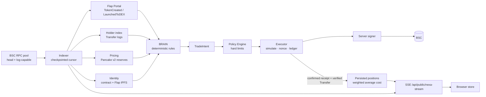

# NEXA

<p align="center">
  
</p>

<p align="center"><strong>Autonomous onchain agent for Flap on BNB Smart Chain.</strong></p>

<p align="center">
  <a href="https://x.com/nexa_agentbsc">X / Twitter</a> ·
  <a href="https://id-preview--e2307a45-17ba-43c1-a32a-ff5d91c27eec.lovable.app">Live app preview</a> ·
  <a href="docs/BUILD_YOUR_OWN.md">Build Your Own NEXA</a>
</p>

NEXA observes BNB Smart Chain, discovers Flap launches, evaluates verifiable market signals, applies hard risk policy, and prepares or executes trades through a server-only signer boundary. Missing or stale inputs stay explicitly unavailable; NEXA never fills gaps with synthetic activity.

## What it does

- Indexes BSC blocks and Flap launch events through a resilient, checkpointed RPC pool.
- Resolves token identity from contracts and Flap-linked IPFS metadata, with clearly non-official fallback avatars.
- Produces structured decisions, reason codes, and auditable receipts from real snapshots.
- Protects capital with hard limits, quote freshness, lifecycle routing, simulation, duplicate protection, and an emergency stop.
- Opens positions only after confirmed transactions and verified token transfers; dry runs never create ownership.
- Streams one bounded normalized event feed to the browser for live activity, proof, memory, positions, and replay.

## Live architecture



The browser never calls RPC and never receives signing or service secrets. One server indexer feeds one bounded SSE stream. Token logos come only from Flap-linked IPFS metadata. Positions exist only after confirmed live receipts prove ownership; dry runs remain separate.

## Safety model

- **Server-only signing:** BRAIN emits a structured `TradeIntent`; Policy validates it before Executor can reach Signer.
- **Real data or unavailable:** stale prices, incomplete holder indexing, unhealthy RPC, unknown lifecycle, or unverified contracts block execution.
- **Proof before positions:** confirmed receipts and verified `Transfer` logs are required before position accounting begins.
- **Hard limits win:** adaptive risk can reduce exposure but cannot raise configured ceilings.
- **Conservative default:** emergency stop is enabled in the example configuration.

See [SECURITY.md](SECURITY.md) and [docs/SECURITY.md](docs/SECURITY.md) before configuring a signer.

## Execution modes

| Mode | Purpose |
|---|---|
| `NO_SIGNER` | Observe only; no usable server signer. |
| `SIGNER_READY` | Signer identity verified; broadcasting remains disabled. |
| `DRY_RUN` | Full policy and simulation path, without broadcast or fake hashes. |
| `LIVE_LIMITED` | Explicitly activated real execution within conservative hard limits. |
| `LIVE_AUTONOMOUS` | Unattended execution after every readiness gate passes. |

Live modes activate only when every readiness check passes. `LIVE_AUTONOMOUS` additionally requires `NEXA_LIVE_AUTONOMOUS_CONFIRM=I_ACCEPT_UNATTENDED_RISK`.

## Quick start

```bash
git clone https://github.com/Broken18k/nexa.git
cd nexa
cp .env.example .env
bun install
bun run dev
```

Open `http://localhost:8080`. Fill server configuration in `.env`, but use your deployment platform's encrypted secret store for private credentials. The browser-facing app must never receive signer or service secrets.

## Build Your Own NEXA

The fork guide covers RPC providers, a public agent wallet, Flap configuration, durable indexer state, signer isolation, policy limits, deployment, and the optional social publisher. Start with [docs/BUILD_YOUR_OWN.md](docs/BUILD_YOUR_OWN.md).

## Documentation

- [Build Your Own NEXA](docs/BUILD_YOUR_OWN.md) — fork, configure, and operate your own agent.
- [Flap](docs/FLAP.md) — verified protocol research, contracts, trading surface, and unresolved checks.
- [Architecture](docs/ARCHITECTURE.md) — system boundaries and data flow.
- [Providers](docs/PROVIDERS.md) — RPC, Flap, pricing, holders, identity, and positions.
- [Events](docs/EVENTS.md) — normalized event contract and truthfulness rules.
- [Autonomy](docs/AUTONOMY.md) — counters, protection, risk adaptation, receipts, and replay.
- [Security](docs/SECURITY.md) — signer boundary and activation checklist.
- [Security policy](SECURITY.md) — reporting and operator guidance.

## Roadmap

- Complete the verified direct Flap bonding-curve adapter and real quote simulations.
- Validate the first real end-to-end dry run without broadcasting.
- Move local durable state to shared storage for multi-instance deployments.
- Keep live execution gated until every onchain, signer, pricing, policy, and operator precondition passes.

## Deployment

NEXA runs as a TanStack Start app on an edge/serverless runtime. The file-based cursor, holder index and execution ledger (`.data/*`) require durable storage. Multi-instance deployments should use shared persistence and one elected indexer. No Docker image is provided yet.

## Disclaimer

NEXA is experimental financial software. Review all configuration and code, use a dedicated low-balance wallet, and never use a key that has appeared in chat, logs, source control, or browser storage.
